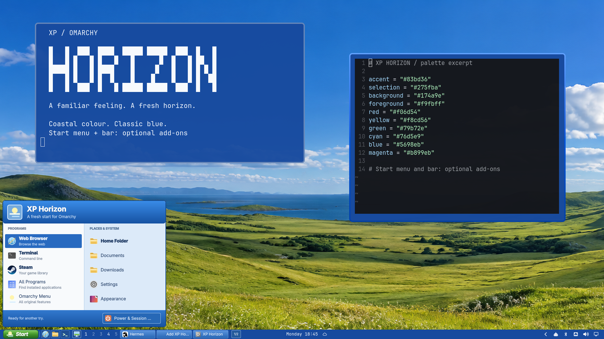

# Omarchy XP Horizon — base theme

**A familiar feeling. A fresh horizon.**



A coastal Omarchy colour theme with an original Horizon wallpaper. This repository is the **base theme only**: it contains `colors.toml`, `icons.theme`, `backgrounds/horizon-coast.png` and `preview.png`. It does **not** install the XP Start menu, Quick Launch, Show Desktop, Task Buttons, 4 px window borders/6 px corners, screensaver branding or startup sound.

Install the base theme with Omarchy's **Install → Style → Theme** menu and paste:

```text
https://github.com/rogunlimited-hub/omarchy-xp-horizon-theme
```

Equivalent command: `omarchy theme install https://github.com/rogunlimited-hub/omarchy-xp-horizon-theme.git`. This is the same standard one-URL installation flow as other community themes. Do not use the combined-package ZIP as a theme repository: its theme files are nested in `theme/`.

The preview is a real 1920×1080 desktop screenshot with a terminal, an editor displaying a theme-palette excerpt, the open Horizon Start menu and the full bottom bar. It shows the **optional, separately installed add-ons**, not what the base theme alone installs. The base theme will not move your bar. Yaru-blue is a separately installed system icon theme, referenced but not bundled.

The optional **[v1.0.0 combined package](https://github.com/rogunlimited-hub/omarchy-xp-horizon-theme/releases/tag/v1.0.0)** is a separate manual installation for Omarchy 4.0.6 / Quickshell 0.3.2 / Hyprland Lua, with four plugins, window styling, screensaver integration and opt-in startup audio. **Choose either the base-theme installation above or the full package from a clean system; do not install the base first and then run the full installer.** It refuses an existing XP Horizon theme path and does not migrate one. The combined archive has its own scoped uninstall and safety checks; ordinary repository-theme installation never executes it. No security filter is bypassed.

The supplied coast image was generated through a ChatGPT workflow and supplied by Roger; it is not a camera photograph or represented as exclusively owned. Original code/configuration is MIT; covered original media is CC BY 4.0. See `LICENSE`, `LICENSES/CC-BY-4.0.txt`, and `ATTRIBUTION.md`. XP Horizon is independent of Microsoft and is not endorsed by it. The full package is available separately on the [release page](https://github.com/rogunlimited-hub/omarchy-xp-horizon-theme/releases/tag/v1.0.0).
